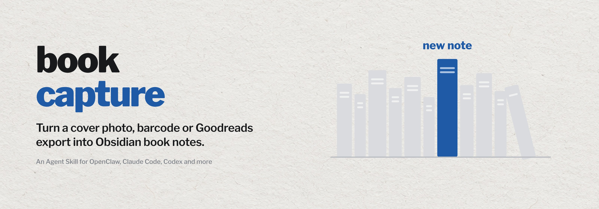

<picture>
  <source media="(prefers-color-scheme: dark)" srcset="assets/banner-dark.jpg">
  
</picture>

<p align="center">
  <a href="LICENSE"></a>
  
  <a href="https://clawhub.ai/ricardodpalmeida/skills/book-capture-obsidian"></a>
  <a href="https://github.com/Ricardodpalmeida/book-capture-obsidian-skill/actions/workflows/ci.yml"></a>
</p>

Logging a book should take one photo, not ten minutes of typing. **Book Capture for Obsidian** is an Agent Skill that turns a cover photo, a barcode, an ISBN, a title or a whole Goodreads export into Obsidian book notes, with covers, summaries and a library dashboard. Choose Google Books only, Open Library only, or both in either order. Re-runs update the books they match and never touch what you wrote under `## User Notes`.

## What you get

One note per book, filed under `Books/` and named after its title, author, publisher and year. This one was written by `upsert_obsidian_note.py` from sample metadata:

```markdown
---
title: "Structure and Interpretation of Computer Programs"
author:
  - "Harold Abelson"
  - "Gerald Jay Sussman"
publisher: "MIT Press"
year: 1996
isbn_10: "0262510871"
isbn_13: "9780262510875"
cover: "https://covers.openlibrary.org/b/isbn/9780262510875-L.jpg"
shelf: "inbox"
source: "manual"
source_url: "https://openlibrary.org/isbn/9780262510875"
tags:
  - "book"
  - "programming"
  - "computer-programming"
---

# Structure and Interpretation of Computer Programs

## Summary
A classic introduction to programming through abstraction, recursion and interpreters, taught in Scheme.

## User Notes
```

Everything above `## User Notes` is generated and refreshed on the next run; everything below it is yours. A `Library Dashboard` note counts the books on each shelf (inbox, to read, reading, read) and lists recent additions and current reads with Dataview.

## How it works

1. A photo goes through barcode reading first and OCR second, with whichever of zbar, pyzbar and Tesseract is installed. A typed ISBN, a title or a Goodreads CSV skips this step.
2. The metadata comes from the providers you chose, in your order, with a local cache, request pacing and a pause that persists across runs when Google reports a quota limit.
3. Each book gets one note, matched by ISBN or Goodreads ID, so re-runs update and refile notes instead of duplicating them, and never delete one. Titles and summaries from outside are escaped, so they cannot inject code or Dataview queries.
4. The dashboard is rebuilt from the notes' frontmatter.

Every script answers with a JSON envelope of `ok`, `error` and `warnings`, and the agent reads it before it reports success. A Goodreads import runs as a dry run first, so you see the counts and errors before anything is written.

## Choose a metadata provider

| `BOOK_CAPTURE_METADATA_PROVIDER_ORDER` | Behavior |
| --- | --- |
| `openlibrary,google_books` | Default; Open Library first, Google fills gaps |
| `google_books,openlibrary` | Google first; Open Library fills gaps |
| `google_books` | Google only, even on misses or quota errors |
| `openlibrary` | Open Library only |

Open Library needs no key but is rate limited. For Google, enable the Books API in your Cloud project and supply `BOOK_CAPTURE_GOOGLE_API_KEY` privately. Paid Cloud billing does not guarantee extra Books quota; the [configuration guide](skill/book-capture-obsidian/references/configuration.md#metadata-providers-and-api-requirements) covers quotas, pacing and resumable imports.

## Install

OpenClaw is the primary target:

```bash
openclaw skills install @ricardodpalmeida/book-capture-obsidian            # this workspace
openclaw skills install @ricardodpalmeida/book-capture-obsidian --global   # all agents
```

The skill folder is a standard Agent Skill, so other agents that read `SKILL.md` can use it too. Copy `skill/book-capture-obsidian` into the agent's skills folder, for example `~/.claude/skills/` for Claude Code or `~/.codex/skills/` for Codex. The instructions call that folder `{baseDir}`: OpenClaw fills it in, and elsewhere it means the folder you copied.

It needs Python 3.10 or newer and an existing vault. On Linux and macOS, `sh <skill-folder>/scripts/setup.sh` creates the skill's own environment and installs its dependencies; Windows steps and every setting are in the [configuration guide](skill/book-capture-obsidian/references/configuration.md). Photos also need zbar, Tesseract or both: `zbar-tools tesseract-ocr` on Debian and Ubuntu, `zbar tesseract` on Homebrew. ISBN, title and CSV workflows work without them.

Then ask in plain words: "log this book" with a photo, "add ISBN 9780262510875 to my to-read shelf", or "import my Goodreads export into Obsidian".

## Run the scripts yourself

From this repository, after `pip install -r requirements.txt`, with `PY` as that environment's Python:

```bash
PY skill/book-capture-obsidian/scripts/ingest_photo.py --image book.jpg --vault-path /path/to/vault
PY skill/book-capture-obsidian/scripts/migrate_goodreads_csv.py --csv export.csv --vault-path /path/to/vault --dry-run
PY skill/book-capture-obsidian/scripts/generate_dashboard.py --vault-path /path/to/vault
```

Check the dry-run counts and errors, then drop `--dry-run` to import. For large exports, try a small batch first or use `--no-enrich` for a local CSV-only import. The [migration runbook](skill/book-capture-obsidian/references/migration-runbook.md) covers the rest.

## Privacy

Only ISBN, title and author queries go to the metadata providers you chose. The scripts leave your photos where they are, never upload photos or vault contents, and redact the Google key from metadata and errors. Obsidian itself may fetch remote cover images.

## What is inside

```
skill/book-capture-obsidian/
├── SKILL.md                 setup, provider choice, workflows, data rules
├── scripts/                 photo ingest, ISBN extraction, metadata lookup and cache,
│                            note upsert, Goodreads migration, dashboard, setup.sh
├── references/              configuration, data contracts, migration runbook,
│                            troubleshooting
├── assets/templates/        book note and library dashboard templates
└── tests/                   unit tests
scripts/                     CI, privacy scan and packaging helpers
```

To run the same checks as CI and build a release package:

```bash
pip install -r requirements-dev.txt
sh scripts/run_ci_local.sh
sh scripts/package_skill_local.sh --with-security-scan
```

The package helper writes `dist/book-capture-obsidian-<timestamp>.skill.tgz` with a checksum. Use [RELEASE_READINESS.md](RELEASE_READINESS.md) before publishing, and see [CHANGELOG.md](CHANGELOG.md) for release notes and [SECURITY.md](SECURITY.md) for what the privacy scan checks.

## License

[MIT-0](LICENSE). Use, share, modify and redistribute it, including commercially, without an attribution requirement. The same license applies on ClawHub.

## Author

**Ricardo Pacheco Almeida**, Senior AI Tech Lead and Architect and PhD student researching enterprise and solution architectures for generative AI, including multi-agent structures.

[Website](https://me.ricbits.cc/en/) · [LinkedIn](https://www.linkedin.com/in/ricardodpa/) · [GitHub](https://github.com/Ricardodpalmeida) · [ClawHub](https://clawhub.ai/ricardodpalmeida)

More skills by the same author:

| Skill | What it does |
|---|---|
| [data-storycraft](https://github.com/Ricardodpalmeida/data-storycraft-skill) | Turn analysis into charts, slides and reports that make the point |
| [Whetstone](https://github.com/Ricardodpalmeida/whetstone) | Scale your coding agent's engineering care to the risk of each change |
| [Excalidraw Diagrams](https://github.com/Ricardodpalmeida/openclaw-excalidraw-diagrams) | Draw clean, hand-drawn Excalidraw diagrams for Obsidian or excalidraw.com |
| [Microsoft Learn MCP](https://github.com/Ricardodpalmeida/openclaw-mslearn-mcp) | Ground Microsoft answers in current Learn docs and code samples |
| [LadybugDB openCypher](https://clawhub.ai/ricardodpalmeida/skills/ladybug-opencypher-updated) | Work with LadybugDB property graphs using openCypher and Python |
